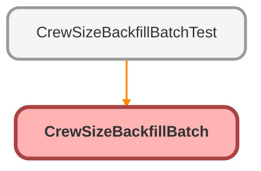

<!-- This file is auto-generated. if you do not want it to be overwritten, set TRUE in the line below -->
<!-- DO_NOT_OVERWRITE_DOC=FALSE -->

# CrewSizeBackfillBatch Class

Sample for Lab 2.3. Copy it into force-app/main/default/classes/ as it is. 
boop 
Gives every installation without a crew size the default crew of two, so that 
Crew_Size__c can be required. A batch works through the table in chunks, each 
chunk in a transaction of its own, so it holds whatever the size of the table: 
thirty records in a scratch org, ten million in production. A plain script 
that updates every record at once stops at the first governor limit it meets.

**Implements**

Database.Batchable<SObject>

## Class Diagram



<!-- Apex description -->

## Apex Code

```java
/**
 * Sample for Lab 2.3. Copy it into force-app/main/default/classes/ as it is.
 *boop
 * Gives every installation without a crew size the default crew of two, so that
 * Crew_Size__c can be required. A batch works through the table in chunks, each
 * chunk in a transaction of its own, so it holds whatever the size of the table:
 * thirty records in a scratch org, ten million in production. A plain script
 * that updates every record at once stops at the first governor limit it meets.
 */
public with sharing class CrewSizeBackfillBatch implements Database.Batchable<SObject> {
  public static final Integer DEFAULT_CREW = 2;

  public Database.QueryLocator start(Database.BatchableContext context) {
    return Database.getQueryLocator('SELECT Id, Crew_Size__c FROM Installation__c WHERE Crew_Size__c = null');
  }

  public void execute(Database.BatchableContext context, List<Installation__c> installations) {
    for (Installation__c installation : installations) {
      installation.Crew_Size__c = DEFAULT_CREW;
    }
    update installations;
  }

  // The debug log is where the deployment job shows that the backfill ended
  @SuppressWarnings('PMD.AvoidDebugStatements')
  public void finish(Database.BatchableContext context) {
    System.debug(LoggingLevel.INFO, 'Crew size backfill finished');
  }
}
```

## Fields
### `DEFAULT_CREW`

#### Signature
```apex
public static final DEFAULT_CREW
```

#### Type
Integer

## Methods
### `start(context)`

#### Signature
```apex
public Database.QueryLocator start(Database.BatchableContext context)
```

#### Parameters
| Name | Type | Description |
|------|------|-------------|
| context | Database.BatchableContext |  |

#### Return Type
**Database.QueryLocator**

---

### `execute(context, installations)`

#### Signature
```apex
public void execute(Database.BatchableContext context, List<Installation__c> installations)
```

#### Parameters
| Name | Type | Description |
|------|------|-------------|
| context | Database.BatchableContext |  |
| installations | List<Installation__c> |  |

#### Return Type
**void**

---

### `finish(context)`

`SUPPRESSWARNINGS`

#### Signature
```apex
public void finish(Database.BatchableContext context)
```

#### Parameters
| Name | Type | Description |
|------|------|-------------|
| context | Database.BatchableContext |  |

#### Return Type
**void**