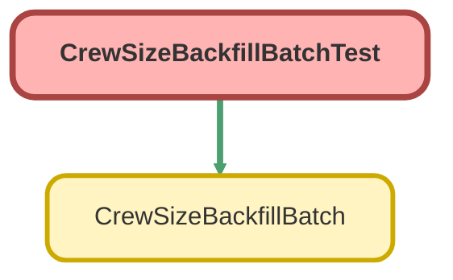

<!-- This file is auto-generated. if you do not want it to be overwritten, set TRUE in the line below -->
<!-- DO_NOT_OVERWRITE_DOC=FALSE -->

# CrewSizeBackfillBatchTest Class

`ISTEST`

Sample for Lab 2.3. Copy it into force-app/main/default/classes/ as it is. 
boop 
Once this story is deployed, Crew_Size__c is required and no installation 
without one can be inserted, not even by a test. So the test inserts a valid 
record and hands the batch that record as it was before the story: with no 
crew size.

## Class Diagram



<!-- Apex description -->

## Apex Code

```java
/**
 * Sample for Lab 2.3. Copy it into force-app/main/default/classes/ as it is.
 *boop
 * Once this story is deployed, Crew_Size__c is required and no installation
 * without one can be inserted, not even by a test. So the test inserts a valid
 * record and hands the batch that record as it was before the story: with no
 * crew size.
 */
@isTest
private class CrewSizeBackfillBatchTest {
  @isTest
  static void givesTheDefaultCrewToAnInstallationWithoutOne() {
    Installation__c installation = new Installation__c(
      External_Id__c = 'INST-BACKFILL-1',
      Status__c = 'Planned',
      Crew_Size__c = 3
    );
    insert installation;
    Installation__c withoutCrew = new Installation__c(Id = installation.Id, Crew_Size__c = null);

    Test.startTest();
    Database.executeBatch(new CrewSizeBackfillBatch(), 200);
    new CrewSizeBackfillBatch().execute(null, new List<Installation__c>{ withoutCrew });
    Test.stopTest();

    Installation__c backfilled = [SELECT Crew_Size__c FROM Installation__c WHERE Id = :installation.Id];
    Assert.areEqual(CrewSizeBackfillBatch.DEFAULT_CREW, backfilled.Crew_Size__c, 'The installation gets the default crew');
  }
}
```

## Methods
### `givesTheDefaultCrewToAnInstallationWithoutOne()`

`ISTEST`

#### Signature
```apex
private static void givesTheDefaultCrewToAnInstallationWithoutOne()
```

#### Return Type
**void**