<!-- This file is auto-generated. if you do not want it to be overwritten, set TRUE in the line below -->
<!-- DO_NOT_OVERWRITE_DOC=FALSE -->

# Installation Close Check

## Flow Diagram [(_View History_)](Installation_Close_Check-history.md)

<!-- Flow description -->

## General Information

|<!-- -->|<!-- -->|
|:---|:---|
|Object|Installation__c|
|Process Type|Auto Launched Flow|
|Trigger Type|Record Before Save|
|Record Trigger Type|Update|
|Label|Installation Close Check|
|Status|Active|
|Does Require Record Changed To Meet Criteria|✅|
|Description|An installation cannot be closed without an install date.|
|Environments|Default|
|Interview Label|Installation Close Check {!$Flow.CurrentDateTime}|
|BuilderType (PM)|LightningFlowBuilder|
|CanvasMode (PM)|AUTO_LAYOUT_CANVAS|
|Connector|[No_Install_Date](#no_install_date)|
|Next Node|[No_Install_Date](#no_install_date)|

#### Filters (logic: **and**)

|Filter Id|Field|Operator|Value|
|:-- |:-- |:--:|:--: |
|1|Status__c|Equal To|Completed|

## Variables

|Name|Data Type|Is Collection|Is Input|Is Output|Object Type|Description|
|:-- |:--:|:--:|:--:|:--:|:--:|:--  |
|var_Error|String|⬜|⬜|⬜|<!-- -->|A resource that contains errors|

## Flow Nodes Details

### Assign_Error

|<!-- -->|<!-- -->|
|:---|:---|
|Type|Assignment|
|Label|Assign Error|
|Description|Is the error assigned somewhere we can access it? Nope|

#### Assignments

|Assign To Reference|Operator|Value|
|:-- |:--:|:--: |
|var_Error|Assign|$Flow.FaultMessage|

### Install_Date_Missing

|<!-- -->|<!-- -->|
|:---|:---|
|Type|Custom Error|
|Label|Install Date Missing|
|Description|Refuses to close an installation that was never given an install date.|
|Custom Error Messages|errorMessage: Set the install date before closing this installation. isFieldError: false |
|Connector|[Get_Uncompleted_Handover_Items](#get_uncompleted_handover_items)|

### Uncompleted_Items_Errors

|<!-- -->|<!-- -->|
|:---|:---|
|Type|Custom Error|
|Label|Uncompleted Items Errors|
|Description|Refuses to close an installation with uncompleted handover items.|
|Custom Error Messages|errorMessage: Complete your handover items before marking the installation complete. isFieldError: false |

### Found_Uncompleted_Items

|<!-- -->|<!-- -->|
|:---|:---|
|Type|Decision|
|Label|Found Uncompleted Items?|
|Description|Were uncompleted handover items found?|
|Default Connector Label|Default Outcome|

#### Rule Uncompleted_items (Uncompleted items)

|<!-- -->|<!-- -->|
|:---|:---|
|Connector|[Uncompleted_Items_Errors](#uncompleted_items_errors)|
|Condition Logic|and|

|Condition Id|Left Value Reference|Operator|Right Value|
|:-- |:-- |:--:|:--: |
|1|[Get_Uncompleted_Handover_Items](#get_uncompleted_handover_items)|Is Empty|⬜|

### No_Install_Date

|<!-- -->|<!-- -->|
|:---|:---|
|Type|Decision|
|Label|No Install Date|
|Description|Was the installation ever given an install date?|
|Default Connector|[Get_Uncompleted_Handover_Items](#get_uncompleted_handover_items)|
|Default Connector Label|Install date set|

#### Rule Date_Missing (Date missing)

|<!-- -->|<!-- -->|
|:---|:---|
|Connector|[Install_Date_Missing](#install_date_missing)|
|Condition Logic|and|

|Condition Id|Left Value Reference|Operator|Right Value|
|:-- |:-- |:--:|:--: |
|1|$Record.Install_Date__c|Is Null|True|

### Get_Uncompleted_Handover_Items

|<!-- -->|<!-- -->|
|:---|:---|
|Type|Record Lookup|
|Object|Handover_Item__c|
|Label|Get Uncompleted Handover Items|
|Description|Find handover items that have not been completedq|
|Assign Null Values If No Records Found|⬜|
|Fault Connector|[Assign_Error](#assign_error)|
|Get First Record Only|⬜|
|Store Output Automatically|✅|
|Connector|[Found_Uncompleted_Items](#found_uncompleted_items)|

#### Filters (logic: **and**)

|Filter Id|Field|Operator|Value|
|:-- |:-- |:--:|:--: |
|1|Installation__c|Equal To|$Record.Id|
|2|Is_Done__c|Equal To|⬜|

___

_Documentation generated from branch monitoring_orgfarm_01772716d5_dev_ed_develop by [sfdx-hardis](https://sfdx-hardis.cloudity.com), featuring [salesforce-flow-visualiser](https://github.com/toddhalfpenny/salesforce-flow-visualiser)_