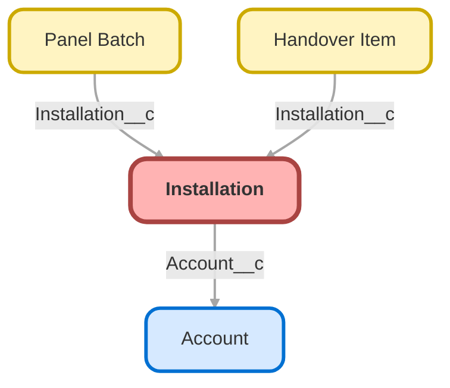

<!-- This file is auto-generated. if you do not want it to be overwritten, set TRUE in the line below -->
<!-- DO_NOT_OVERWRITE_DOC=FALSE -->

# Installation__c

## Schema

<!-- Object description -->

## Fields

| Name | Label | Type | Description |
| :-------- | :---- | :--: | :---------- | 
| Account__c | Account | Lookup | The customer whose roof this is. |
| Crew_Capacity_Cap__c | Crew Capacity Cap | Number | The largest crew this installation can take. Above it, people get in each other's way on the roof. |
| Crew_Notes__c | Crew Notes | LongTextArea | Notes from da crew |
| Crew_Size__c | Crew Size | Number | How many people are assigned to this job. Level 2 makes it mandatory. |
| Crew_Warning_Sent__c | Crew Warning Sent | Checkbox | If checked, indicates that the warning flow has already run for this installation. |
| Crew_Workload__c | Crew Workload | Number | Panels each person of the crew has to lay on this job. |
| External_Id__c | External Id | Text | Stable key used by the training data loader. Never edit it by hand. |
| Gate_Code__c | Gate Code | Text | The code of the gate or the entrance of the site, as the customer gave it to the planner. |
| Install_Date__c | Install Date | Date | The day the crew is expected on site. |
| Panels_Required__c | Panels Required | Number | How many panels the crew has to load for this installation. |
| Roof_Type__c | Roof Type | Picklist | Drives how long the job takes. |
| Scaffolding_Required__c | Scaffolding Required | Checkbox | Set by the planner when the roof cannot be reached without scaffolding, so the crew books it before the day. |
| Signed_Off_By__c | Signed Off By | Text | Who signed the installation off with the customer. |
| Status__c | Status | Picklist | Where this installation stands. |
| Total_Capacity_kW__c | Total Capacity kW | Number | Total installed capacity once every panel is on the roof. |

## Validation Rules

| Rule | Active | Description | Formula |
| :-------- | :---- | :---------- | :------ |
| Installation_Date_Not_Past | Yes | A planner cannot move an installation into the past. Completed jobs are exempt, and the rule stays quiet on insert so the training data can be loaded. | <code>AND(   ISCHANGED(Install_Date__c),   Install_Date__c &lt; TODAY(),   NOT(ISPICKVAL(Status__c, "Completed")),   NOT(ISPICKVAL(Status__c, "Cancelled")) )</code> |

## Related Flows

| Object | Name | Type | Description | Status |
| :----  | :-------- | :--: | :---------- | :----- |
| Installation__c | [Installation_Assign_Crew](../flows/Installation_Assign_Crew.md) [🕒](../flows/Installation_Assign_Crew-history.md) | Record Before Save | When a planner puts a crew on a planned installation that already has a date, the installation moves to Scheduled on its own. A crew larger than the installation cap is brought back down to the cap: too many people on a small roof is a safety problem. | Active |
| Installation__c | [Installation_Close_Check](../flows/Installation_Close_Check.md) [🕒](../flows/Installation_Close_Check-history.md) | Record Before Save | An installation cannot be closed without an install date. | Active |
| Installation__c | [Installation_Crew_Warning](../flows/Installation_Crew_Warning.md) [🕒](../flows/Installation_Crew_Warning-history.md) | Record After Save | Warns the planner when the crew assigned to an installation is too small for the panels it needs. | Active |

## Related Apex Classes

| Apex Class | Type |
| :----      | :--: | 
| [CrewCapacityBatch](../apex/CrewCapacityBatch.md) | Batch |
| [CrewCapacityBatchTest](../apex/CrewCapacityBatchTest.md) | Test |
| [CrewSizeBackfillBatch](../apex/CrewSizeBackfillBatch.md) | Batch |
| [CrewSizeBackfillBatchTest](../apex/CrewSizeBackfillBatchTest.md) | Test |
| [InstallationScheduler](../apex/InstallationScheduler.md) | Class |
| [InstallationSchedulerTest](../apex/InstallationSchedulerTest.md) | Test |

## Related Lightning Web Components

| Component | Description | Exposed | Targets |
| :-------- | :---------- | :-----: | :------------- |
| [installationTimeline](../lwc/installationTimeline.md) | Shows the panel batches booked for an installation, in arrival order. | ✅ | lightning__RecordPage |

## Related Lightning Pages

| Lightning Page | Type |
| :----      | :--: | 
| [Installation_Record_Page](../pages/Installation_Record_Page.md) | Record Page |

## Related Profiles

| Profile | User License |
| :----      | :--: | 
| [Admin](../profiles/Admin.md) | Salesforce |
| [Analytics Cloud Integration User](../profiles/Analytics%20Cloud%20Integration%20User.md) | Analytics Cloud Integration User |
| [Analytics Cloud Security User](../profiles/Analytics%20Cloud%20Security%20User.md) | Analytics Cloud Integration User |
| [Anypoint Integration](../profiles/Anypoint%20Integration.md) | Identity |
| [Authenticated Website](../profiles/Authenticated%20Website.md) | Authenticated Website |
| [B2B Reordering Portal Buyer Profile](../profiles/B2B%20Reordering%20Portal%20Buyer%20Profile.md) | External Apps Login |
| [Chatter External User](../profiles/Chatter%20External%20User.md) | Chatter External |
| [Chatter Free User](../profiles/Chatter%20Free%20User.md) | Chatter Free |
| [Chatter Moderator User](../profiles/Chatter%20Moderator%20User.md) | Chatter Free |
| [ContractManager](../profiles/ContractManager.md) | Salesforce |
| [Cross Org Data Proxy User](../profiles/Cross%20Org%20Data%20Proxy%20User.md) | XOrg Proxy User |
| [Custom%3A Marketing Profile](../profiles/Custom%253A%20Marketing%20Profile.md) | Salesforce |
| [Custom%3A Sales Profile](../profiles/Custom%253A%20Sales%20Profile.md) | Salesforce |
| [Custom%3A Support Profile](../profiles/Custom%253A%20Support%20Profile.md) | Salesforce |
| [Customer Community Login User](../profiles/Customer%20Community%20Login%20User.md) | Customer Community Login |
| [Customer Community Plus Login User](../profiles/Customer%20Community%20Plus%20Login%20User.md) | Customer Community Plus Login |
| [Customer Community Plus User](../profiles/Customer%20Community%20Plus%20User.md) | Customer Community Plus |
| [Customer Community User](../profiles/Customer%20Community%20User.md) | Customer Community |
| [Customer Portal Manager Custom](../profiles/Customer%20Portal%20Manager%20Custom.md) | Customer Portal Manager Custom |
| [Customer Portal Manager Standard](../profiles/Customer%20Portal%20Manager%20Standard.md) | Customer Portal Manager Standard |
| [Einstein Agent User](../profiles/Einstein%20Agent%20User.md) | Einstein Agent |
| [External Apps Login User](../profiles/External%20Apps%20Login%20User.md) | External Apps Login |
| [External Einstein Agent User](../profiles/External%20Einstein%20Agent%20User.md) | External Einstein Agent |
| [External Identity User](../profiles/External%20Identity%20User.md) | External Identity |
| [Force%2Ecom - App Subscription User](../profiles/Force%252Ecom%20-%20App%20Subscription%20User.md) | Force.com - App Subscription |
| [Force%2Ecom - Free User](../profiles/Force%252Ecom%20-%20Free%20User.md) | Force.com - Free |
| [Gold Partner User](../profiles/Gold%20Partner%20User.md) | Gold Partner |
| [Helios Crew](../profiles/Helios%20Crew.md) | Salesforce |
| [High Volume Customer Portal User](../profiles/High%20Volume%20Customer%20Portal%20User.md) | High Volume Customer Portal |
| [HighVolumePortal](../profiles/HighVolumePortal.md) | High Volume Customer Portal |
| [Identity User](../profiles/Identity%20User.md) | Identity |
| [MarketingProfile](../profiles/MarketingProfile.md) | Salesforce |
| [Minimum Access - API Only Integrations](../profiles/Minimum%20Access%20-%20API%20Only%20Integrations.md) | Salesforce Integration |
| [Minimum Access - Salesforce](../profiles/Minimum%20Access%20-%20Salesforce.md) | Salesforce |
| [Partner App Subscription User](../profiles/Partner%20App%20Subscription%20User.md) | Partner App Subscription |
| [Partner Community Login User](../profiles/Partner%20Community%20Login%20User.md) | Partner Community Login |
| [Partner Community User](../profiles/Partner%20Community%20User.md) | Partner Community |
| [PlatformPortal](../profiles/PlatformPortal.md) | Authenticated Website |
| [Read Only](../profiles/Read%20Only.md) | Salesforce |
| [Salesforce API Only System Integrations](../profiles/Salesforce%20API%20Only%20System%20Integrations.md) | Salesforce Integration |
| [Silver Partner User](../profiles/Silver%20Partner%20User.md) | Silver Partner |
| [SolutionManager](../profiles/SolutionManager.md) | Salesforce |
| [Standard](../profiles/Standard.md) | Salesforce |
| [StandardAul](../profiles/StandardAul.md) | Salesforce Platform |
| [Work%2Ecom Only User](../profiles/Work%252Ecom%20Only%20User.md) | Work.com Only |

## Related Permission Sets

| Permission Set | User License |
| :----      | :--: | 
| [Helios_Delivery_Crew](../permissionsets/Helios_Delivery_Crew.md) | None |
| [Helios_Delivery_Manager](../permissionsets/Helios_Delivery_Manager.md) | None |

_Documentation generated with [sfdx-hardis](https://sfdx-hardis.cloudity.com), by [Cloudity](https://www.cloudity.com/) & [friends](https://github.com/hardisgroupcom/sfdx-hardis/graphs/contributors)_
